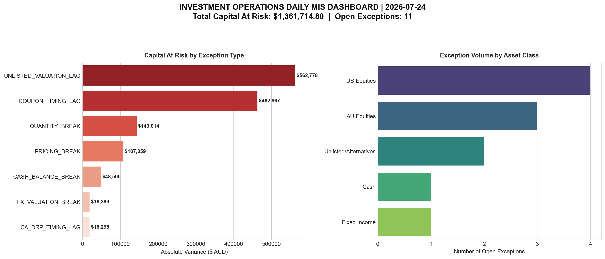

# Investment Operations Reporting Toolkit

[](https://github.com/cohen-pikari/investment-reporting-toolkit/actions/workflows/tests.yml)

A simulated institutional operations desk: generates a fund's daily reconciliation and exception reporting end to end, built as practice for the control function every fund ultimately depends on to know what it actually holds.

## Overview

A fund keeps its own record of what it owns; an independent custodian keeps a separate one. The two rarely match perfectly: trades settle late, prices update on different schedules, corporate actions land at different times. Someone has to work out daily which gaps matter and which are just timing. This project automates that: it compares two sets of position records (synthetic here, standing in for a real fund), classifies every mismatch, judges what needs attention, and produces the same reports a real ops team would use (exception file, dashboard, summary). Some version of this runs inside every asset manager, hedge fund, super fund, insurer, and custodian. No coding needed to read the result below.

## Portfolio

~34 positions across five asset classes (AU equities, US equities, fixed income, unlisted/alternatives, and cash), built to resemble a real diversified super fund rather than a toy example.

## What it does

- Compares the fund's records against the custodian's automatically, flagging anything missing or mismatched on either side. It has only been run on the roughly 34-position synthetic portfolio here, so see Limitations below before assuming it scales.
- Classifies every mismatch into the categories a real exception queue uses (cash, quantity, pricing, FX timing, corporate action lag, illiquid valuation lag, bond coupon timing) instead of lumping everything together as "an error."
- Tells a genuine pricing break apart from ordinary FX timing noise using a defined threshold, the same judgment call that stops a real problem flowing quietly into NAV and stops a false alarm wasting someone's morning.
- Loads results into a small SQL database so they can be queried on their own: total capital at risk, where exceptions cluster, and the Straight-Through Processing rate (the standard measure of how clean the day was).
- Produces the actual outputs an ops team would use: a colour-coded Excel exception report and an executive dashboard.

For the reasoning behind the classification order, see [METHODOLOGY.md](METHODOLOGY.md). For a full trace of one real exception through the actual code, see [WORKED_EXAMPLE.md](WORKED_EXAMPLE.md).

## Structure

- `data/`: synthetic portfolio & warehouse data (generated)
- `output/`: exception reports, dashboards, warehouse extracts
- `scripts/`
  - `generate_synthetic_data.py`: builds the two synthetic record sets (the fund's internal investment book, "IBOR", and the custodian's book, "CBOR")
  - `initialize_warehouse.py`: loads reconciliation output into SQLite
  - `query_warehouse.sql`: risk aggregation queries
  - `generate_ops_dashboard.py`: renders the executive dashboard
  - `generate_excel_sheets.py`: formatted exception report
  - `generate_sql_summary.py`: SQL-driven management summary

## Running it

Needs Python 3.x with `pandas`, `numpy`, `openpyxl`, `matplotlib`, and `seaborn`.

```bash
./run_toolkit.sh
```

Generates a fresh portfolio, runs the reconciliation, classifies exceptions, loads the warehouse, and builds the dashboard, Excel report, and SQL summary. Output lands in `/output`.

## Limitations and next steps

This is a simulation for practising the reasoning behind a reconciliation, not a replacement for one run on a live portfolio. What it can and can't do:

**What it is good for**
- Showing how a reconciliation is structured: two independent records, a defined order of checks, and a classification of every difference.
- Showing why most breaks are timing differences and how a control avoids escalating them as errors.
- Giving a working, tested example to explain and discuss end to end.

**What it does not do**
- **One day only.** It compares a single statement date. Real breaks are tracked over time: how long each has been open, whether it is getting worse, and who owns it. None of that exists here.
- **Known answers.** The generator injects seven categories of break on purpose, so the engine is checked against differences I already know about. Real data produces breaks nobody planned for.
- **Matching by security ID only.** It joins on one clean identifier. Real reconciliations deal with mismatched identifiers across systems, a security master, several accounts and custodians, and settled versus traded positions.
- **Heuristic classification.** The categories come from hand-set rules and thresholds (for example the 0.8% FX band), not from calibration on real data. An "FX valuation break" is labelled because the holding is non-AUD and the gap is small. The engine does not check actual FX rates.
- **Corporate actions and settlement are approximated.** A small quantity shift is treated as a likely dividend reinvestment lag. There is no corporate action feed and no trade or settlement date handling.
- **No workflow or audit trail.** There is no break ownership, comments, sign-off, escalation or maker-checker control, which is most of what a live operations team actually relies on.
- **Light testing and untested at scale.** Two integrity tests (the internal ledger is never altered, no position is dropped) and no run beyond about 34 positions.
- **Stops at classification.** It does not interpret a break or recommend a next step: which team owns it, what to check first, or when it should be escalated. That judgement is what a person in the seat adds.
- **SQL is aggregation only.** The reconciliation itself runs in pandas. The SQL layer summarises the results.

**Possible next steps**
- Multi-day data so breaks can be aged and tracked until cleared.
- Identifier mapping and a simple security master.
- Separate trade date and settlement date handling.
- A break log with an owner and a status.
- A suggested next action and owner for each exception type, and an escalation point such as an age or value threshold.
- Tests for tolerance edge cases, and a comparison against published FX rates.

## Data

Everything here (holdings, prices, quantities) is synthetic, generated by `generate_synthetic_data.py`. No real institutional, client, or employer data is used anywhere in this project.

## Sample output



## Related work

Three different layers of the same investment function: [investment-research-vault](https://github.com/cohen-pikari/investment-research-vault) decides what to own, [price-discovery-lab](https://github.com/cohen-pikari/price-discovery-lab) works out what hard-to-price assets are actually worth, and this one confirms, day to day, that what's recorded is actually real.

## Disclaimer

A personal, self-directed build demonstrating investment operations concepts with entirely synthetic data. Doesn't represent, replicate, or disclose any proprietary systems, data, or processes from any employer, past or present.

Parts of this project were built with AI assistance (Claude). I set the design, review the output and run the work.

Maintained by Cohen Pikari (github.com/cohen-pikari)
